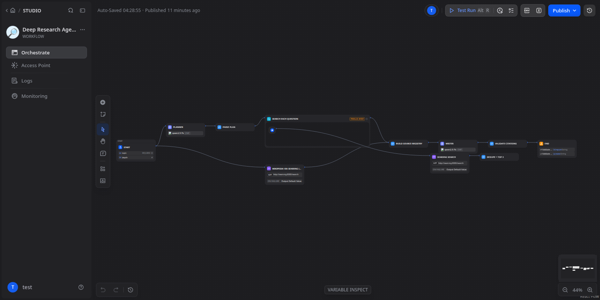
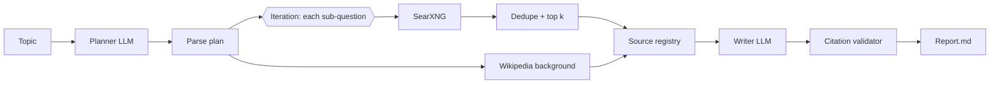

# Dify Research Agent

> Status: tested end to end on self-hosted Dify 1.19.0 with Ollama qwen2.5:7b.
> Four example reports are in [examples/](examples/), each took 45-63 s on one machine. Each has a
> .stats.json: sources found, sources cited, and paragraphs with no citation (4-5 per report).

A multi-step research agent built on Dify. It plans sub-questions, searches with a
self-hosted SearXNG instance, merges the sources, and writes a cited Markdown report.
A final step checks that every citation points to a real source.

Self-hosted stack: Dify + SearXNG (search) + Ollama (local LLM). It uses no paid search or
model APIs. The only key is the Dify app key that your own Dify instance generates.

## Where it runs

Nothing runs on my computer. GitHub Actions ([reports.yml](.github/workflows/reports.yml), manual trigger)
starts Dify 1.19.0, SearXNG and Ollama on a free `ubuntu-latest` runner. It creates a random
throwaway admin, imports [dify/research-agent.yml](dify/research-agent.yml), writes the reports,
opens a PR with them and shuts down. Merging the PR publishes the gallery at
https://dragon28.github.io/dify-research-agent/.

On CPU, one report takes about 4 minutes (235-242 s with qwen2.5:7b) and a full run with one topic took about
10 minutes, including the image and model downloads. Visitors can read the reports but cannot
start runs. There is no always-on Dify editor or chat.

## Run locally (optional, for development)

1. Install Dify with Docker (github.com/langgenius/dify, docker/ folder).
2. Copy infra/docker-compose.override.yml into dify/docker/, then run `docker compose up -d`.
3. Pull the models: `docker exec -it <ollama> ollama pull qwen2.5:7b`
4. Check search works: `make searx-check` (it should return JSON).
5. In dify/docker/.env add `SSRF_PROXY_ALLOW_PRIVATE_DOMAINS=searxng` (Dify's SSRF proxy
   blocks private hosts, so HTTP nodes cannot reach SearXNG without it) and a random
   `SEARXNG_SECRET`. Restricting nginx to this machine is recommended:
   `EXPOSE_NGINX_PORT=127.0.0.1:80`.
6. In Dify, install the Ollama plugin, add model `qwen2.5:7b` (base URL http://ollama:11434,
   context 16384), then import [dify/research-agent.yml](dify/research-agent.yml) and publish.
   `scripts/build_dsl.py` regenerates the DSL from the tested Python in research_agent/.
7. Put the app's API key in .env, then run `make report TOPIC="..."`.

Note: the compose volume path assumes dify/ and dify-research-agent/ are sibling folders.

## Tests

`make setup test` runs the unit tests for all the Code-node logic (plan parsing,
URL dedupe, source numbering, citation validation). CI runs the same tests.

## Limitations

- The runner exits with an error if no sources were retrieved, instead of saving an unsupported report.
- The citation check proves that each [n] points to a retrieved source. It does not
  prove that the source supports the claim.
- Search results depend on the upstream engines SearXNG queries, and those engines
  can rate-limit.
- Local 7B models are weaker than hosted models.
- Needs roughly 12-16 GB of RAM.
- Reports are written from search-result snippets, not full pages, so they are shallow.
- The 7B model does not cite every source it receives (for example only 5 of 12 in the nanopore report).
- If the plugin install fails with `mkdir /app/storage/assets: permission denied`, run
  `docker exec -u 0 docker-plugin_daemon-1 chown -R 1001:1001 /app/storage`.
- There is no hosted live demo, because it needs a GPU or CPU box running Dify. See examples/.

Licences: Dify (modified Apache-2.0), SearXNG (AGPL-3.0), Ollama (MIT).
