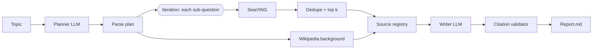

# Dify Research Agent

> Status: the Code-node logic is unit-tested in CI. The full Dify run and the exported
> workflow file are not done yet.

A multi-step research agent built on Dify. It plans sub-questions, searches with a
self-hosted SearXNG instance, merges the sources, and writes a cited Markdown report.
A final step checks that every citation points to a real source.

Self-hosted stack: Dify + SearXNG (search) + Ollama (local LLM). It uses no paid search or
model APIs. The only key is the Dify app key that your own Dify instance generates.

## Run

1. Install Dify with Docker (github.com/langgenius/dify, docker/ folder).
2. Copy infra/docker-compose.override.yml into dify/docker/, then run `docker compose up -d`.
3. Pull the models: `docker exec -it <ollama> ollama pull qwen2.5:7b`
4. Check search works: `make searx-check` (it should return JSON).
5. In Dify, add the Ollama provider (http://ollama:11434), build the workflow from
   dify/WORKFLOW.md (or import research-agent.yml once it is exported), and publish it.
6. Run `export $(cat .env | xargs)` (after filling in .env), then `make report TOPIC="..."`.

Note: the compose volume path assumes dify/ and dify-research-agent/ are sibling folders.

## Tests

`make setup test` runs the unit tests for all the Code-node logic (plan parsing,
URL dedupe, source numbering, citation validation). CI runs the same tests.

## Limitations

- The citation check proves that each [n] points to a retrieved source. It does not
  prove that the source supports the claim.
- Search results depend on the upstream engines SearXNG queries, and those engines
  can rate-limit.
- Local 7B models are weaker than hosted models.
- Needs roughly 12-16 GB of RAM.
- There is no hosted live demo. Sample reports go in examples/.

Licences: Dify (modified Apache-2.0), SearXNG (AGPL-3.0), Ollama (MIT).
